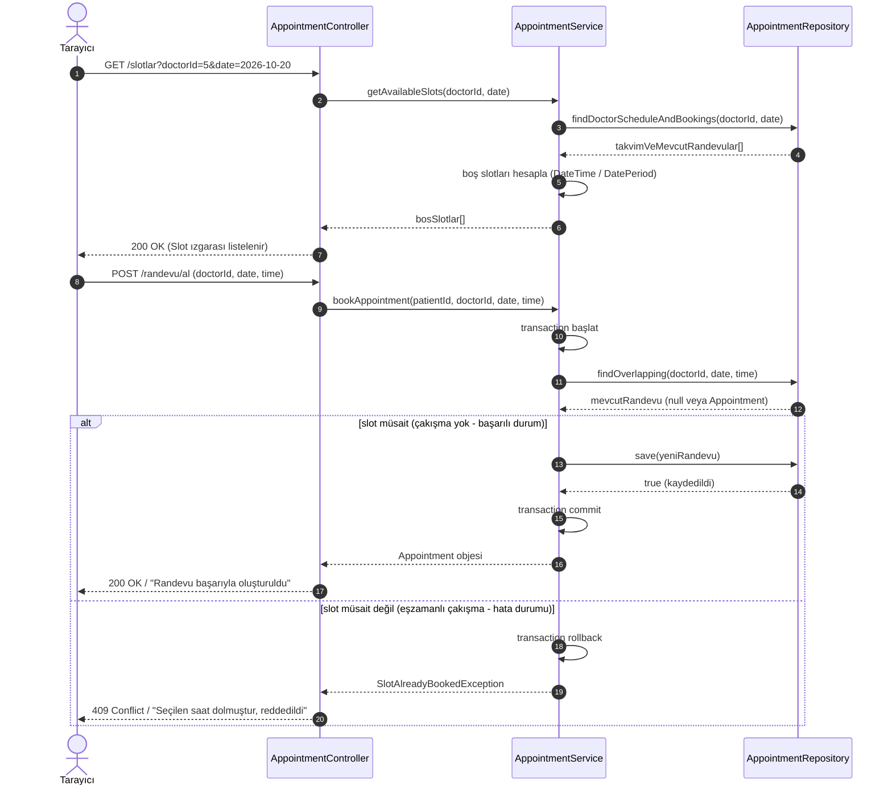
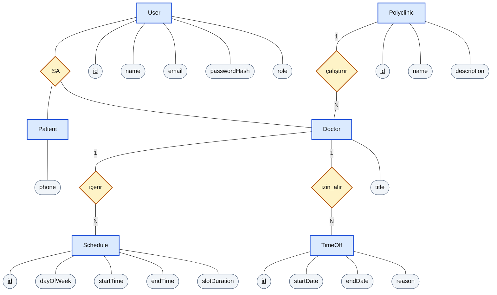
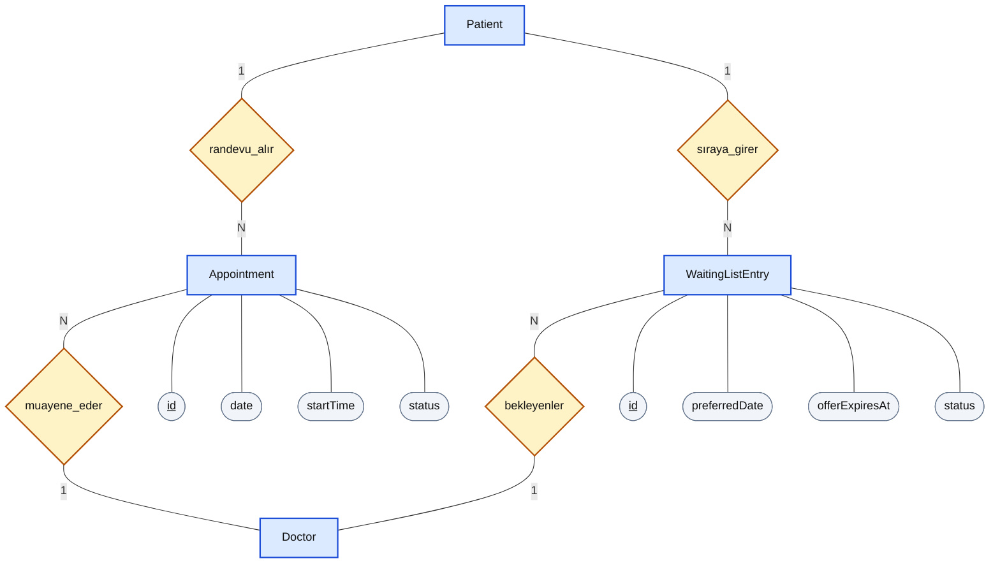

# Klinik Randevu Sistemi Tasarım Belgesi

## Sunum 1 anlatım dağılımı

| Bölüm | Anlatan |
| --- | --- |
| Proje, çekirdek problem, roller ,mimari, 4. ER diyagramı , 7. Riskler, 8. Plan  | Hatice |
| 2. Sınıf diyagramı, 5. Tasarım desenleri,3. Sıralama diyagramı, 6. Arayüz,  | Efe |


## 1. Mimari

## 1.1. Katmanlar

Sistem 5 ana katmandan oluşur. Bağımlılık yönü **yukarıdan aşağıya** doğrudur; alt katmanlar üst katmanları bilmez. Sistemde **4 rol** vardır: Hasta, Doktor, Sekreter ve Admin.

### 1.1.1 Arayüz (View)
- **Görevi:** HTML5 şablonlarını, Bootstrap stillerini ve tarayıcıdaki JavaScript etkileşimlerini içerir. Slotlar, sayfa yenilenmeden `fetch` API ile HTML parçası olarak yüklenir ve DOM'a enjekte edilir.
- **Kural:** İş kuralı ve doğrudan veritabanı sorgusu içeremez.
- **Örnekler:** `views/`, `public/assets/js/slots.js`

### 1.1.2 Controller (İstek ve Yanıt Katmanı)
- **Görevi:** HTTP isteklerini alır, girdiyi doğrular, oturum ve rol yetkisini kontrol eder, ilgili servisi çağırır.
- **Çıktı:** Tam HTML sayfası veya AJAX istekleri için HTML parçası (partial). `application/json` kullanılmaz.
- **Örnekler:** `AppointmentController`, `DoctorController`, `SecretaryController`, `AdminController`

### 1.1.3 Servis (Çekirdek İş Mantığı)
- **Görevi:** Projenin tüm iş kuralları burada yer alır: `DateTime` / `DateInterval` / `DatePeriod` ile slot üretimi, transaction yönetimi, çakışma önleme, bekleme listesi, denetim kaydı, istatistik ve raporlama.
- **Örnekler:** `SlotGeneratorService`, `AppointmentService`, `WaitlistService`, `ReportService`, `DoctorStatsService`, `AuditService`, `DashboardService`

### 1.1.4 Repository (Veri Erişim Katmanı)
- **Görevi:** Veritabanı sorgularının yürütüldüğü katmandır.
- **Kural:** Tüm SQL (PDO, JOIN, `FOR UPDATE` kilitleri) yalnızca burada yazılır.
- **Örnekler:** `AppointmentRepository`, `ScheduleRepository`, `WaitlistRepository`, `AuditLogRepository`

### 1.1.5 Veritabanı
- **Görevi:** MySQL/MariaDB tabloları, kısıtlar (UNIQUE, Foreign Key) ve seed verileri.
- **Tablolar (9):** `users`, `departments`, `doctors`, `schedules`, `time_off`, `blocked_slots`, `appointments`, `waitlist`, `audit_logs`

### 1.1.6 Domain parçaları (katman dışı, paylaşılan)
Enum, entity ve olay sınıfları ilgili modül klasöründe durur (örn. `AppointmentStatus`, `Appointment`, `AppointmentCanceledEvent`). Her katmandan kullanılabilir, ancak hiçbir katmana bağımlı değildir.

### 1.1.7 Modül içi kural
Proje modül bazlı (feature-first) klasörlenmiştir. Her modülde akış **Controller → Service → Repository** sırasını korur. Modüller birbirleriyle servis çağrısı veya olay (event) üzerinden konuşur; bir modül başka bir modülün Repository'sine doğrudan erişmez.


## 1.2. Katman Şeması

```
┌──────────────────────────────────────────────────────────────┐
│  1. ARAYÜZ (Tarayıcı)                                        │
│     views/*.php  ·  Bootstrap CSS  ·  JS (fetch → AJAX)      │
└──────────────────────────┬───────────────────────────────────┘
                           │ HTTP (tam sayfa HTML / HTML parçası)
┌──────────────────────────▼───────────────────────────────────┐
│  public/index.php  →  Router  →  Middleware (Auth, Role)     │
├──────────────────────────────────────────────────────────────┤
│  2. CONTROLLER                                               │
│     AppointmentController · DoctorController ·               │
│     SecretaryController · AdminController ·                  │
│     AuthController · WaitlistController · PatientController  │
│     girdi doğrulama · yetki · HTML yanıt üretme              │
└──────────────────────────┬───────────────────────────────────┘
                           │ servis çağrısı
┌──────────────────────────▼───────────────────────────────────┐
│  3. SERVİS (İş Mantığı)                                      │
│     SlotGeneratorService   AppointmentService (transaction)  │
│     WaitlistService        AuthService       ReportService   │
│     DoctorStatsService     DashboardService  AuditService    │
│            │                                                 │
│            │ olay yayınlar            ┌────────────────────┐ │
│            └─────────────────────────►│ EventDispatcher    │ │
│                                       │ (Observer)         │ │
│        AppointmentCanceledEvent ─────►│ → WaitlistListener │ │
│        (ve diğer olaylar)       ─────►│ → AuditListener    │ │
│                                       └────────────────────┘ │
└──────────────────────────┬───────────────────────────────────┘
                           │ repository çağrısı
┌──────────────────────────▼───────────────────────────────────┐
│  4. REPOSITORY (PDO)                                         │
│     UserRepository · DoctorRepository · ScheduleRepository   │
│     TimeOffRepository · BlockedSlotRepository ·              │
│     AppointmentRepository · WaitlistRepository ·             │
│     DepartmentRepository · AuditLogRepository                │
└──────────────────────────┬───────────────────────────────────┘
                           │ SQL
┌──────────────────────────▼───────────────────────────────────┐
│  5. VERİTABANI (MySQL / MariaDB)                             │
│     users · departments · doctors · schedules · time_off ·   │
│     blocked_slots · appointments · waitlist · audit_logs     │
└──────────────────────────────────────────────────────────────┘

Yan bileşen (tüm katmanlar kullanır):
  DOMAIN → AppointmentStatus · WaitlistStatus · UserRole ·
           Entity'ler · AppointmentCanceledEvent
```

### Örnek akış: Randevu alma

1. Tarayıcı `GET /appointments/slots?doctor=3&week=2026-W42` ile slot ızgarasını AJAX (`fetch`) ile ister.
2. `AppointmentController::slots()` isteği doğrular → `SlotGeneratorService`'i çağırır. Sonuç `views/partials/slot_grid.php` ile HTML parçası olarak döner, JS bunu sayfadaki alana yerleştirir.
3. `SlotGeneratorService`, `ScheduleRepository`, `TimeOffRepository` ve `BlockedSlotRepository`'den veriyi alır; öğle arasını, izinleri ve acil blokları çıkararak slotları üretir; dolu slotları `AppointmentRepository`'den eler.
4. Hasta slotu seçip isteğe bağlı ön not/şikâyet yazar; `POST /appointments` → `AppointmentController::store()` → `AppointmentService::book()`.
5. Servis **transaction** açar, slotu kilitler (`SELECT ... FOR UPDATE`), müsaitse `INSERT` eder. UNIQUE kısıt, eşzamanlı ikinci isteği son savunma olarak reddeder. Çakışma yaşanırsa `SlotAlreadyTakenException` fırlatılır ve olay denetim kaydına yazılır.

### Örnek akış: Randevu tarih/saat değiştirme

1. Hasta `PUT /appointments/{id}/reschedule` ile yeni slot seçer.
2. `AppointmentService::reschedule()` tek transaction içinde yeni slotu kilitler, eski randevuyu serbest bırakır, yenisini yazar.
3. Eski slot boşaldığı için `AppointmentCanceledEvent` benzeri bir olay yayınlanır ve bekleme listesi tetiklenir.

### Örnek akış: İptal ve bekleme listesi

1. `AppointmentService::cancel()` durumu `AppointmentStatus::Canceled` yapar.
2. Servis `AppointmentCanceledEvent` olayını `EventDispatcher`'a verir.
3. `WaitlistListener` olayı yakalar → `WaitlistService::offerNext()` kuyruktaki ilk hastaya 30 dakikalık süreli teklif oluşturur (`Offered`, `expired_at` set edilir). `AuditListener` aynı olayı denetim kaydına yazar.
4. Hasta reddederse (`Declined`) veya süre dolarsa (`Expired`) kuyrukta sıradaki hastaya geçilir. Süresi dolan teklifler `bin/process-waitlist.php` betiğiyle (cron) işlenir.

### Örnek akış: Doktorun hasta durumunu güncellemesi

1. Doktor günlük listede hastanın durumunu işaretler: `POST /doctor/appointments/{id}/status`.
2. `RoleMiddleware` yalnızca ilgili doktorun kendi randevusunu güncellemesine izin verir.
3. `AppointmentService::updateStatus()` durumu `Arrived → InConsultation → Completed` veya `NoShow` olarak ilerletir.

## 1.3. Klasör Yapısı

```
clinic-appointment-system/
├── bin/
│   └── process-waitlist.php          # Süresi dolan teklifleri işler (cron / manuel)
│
├── config/
│   ├── app.php                       # Zaman dilimi (Europe/Istanbul), teklif süresi (30 dk), randevu süresi
│   ├── database.php                  # PDO bağlantı parametreleri
│   ├── routes.php                    # Route tanımları (URL → Controller@method, middleware)
│   ├── services.php                  # DI Container bağlamaları (servis/repository kurulumu)
│   └── events.php                    # Observer kayıtları (olay → dinleyici)
│
├── database/
│   ├── schema.sql                    # 9 tablo DDL (UNIQUE, FK, active_slot_key)
│   └── seeds/
│       └── SeedData.sql              # 4 poliklinik, 6 doktor, takvim, izin, kullanıcılar (4 rol)
│
├── public/                           # DOCUMENT ROOT
│   ├── .htaccess                     # Tüm istekleri index.php'ye yönlendirir
│   ├── index.php                     # Front Controller
│   └── assets/
│       ├── css/                      # Bootstrap 5 + özel CSS
│       └── js/                       # slots.js (fetch/AJAX), geri sayım scriptleri
│
├── src/                              # Namespace: App\
│   ├── Core/                         # Altyapı (iş mantığından bağımsız)
│   │   ├── Container.php             # Basit DI container
│   │   ├── Database.php              # PDO bağlantı üretici + transaction yardımcıları
│   │   ├── View.php                  # Tam sayfa ve partial render motoru
│   │   ├── Event/
│   │   │   └── EventDispatcher.php   # Observer altyapısı
│   │   ├── Middleware/
│   │   │   ├── AuthMiddleware.php    # Oturum kontrolü
│   │   │   └── RoleMiddleware.php    # Rol bazlı erişim (RBAC)
│   │   └── Router/
│   │       ├── Request.php
│   │       ├── Response.php
│   │       └── Router.php            # Regex tabanlı router
│   │
│   ├── Appointment/                  # Randevu modülü
│   │   ├── Appointment.php           # Entity (patient_note alanı dahil)
│   │   ├── AppointmentStatus.php     # Enum: Pending, Confirmed, Arrived, InConsultation, Completed, NoShow, Canceled, Rejected
│   │   ├── AppointmentController.php # Sayfa + AJAX partial; arama/filtre, alma, değiştirme, iptal
│   │   ├── AppointmentService.php    # Alma / iptal / değiştirme / durum güncelleme, transaction
│   │   ├── AppointmentRepository.php # PDO, JOIN, FOR UPDATE, filtreli arama
│   │   ├── SlotGeneratorService.php  # DateTime/DateInterval/DatePeriod slot motoru
│   │   ├── Event/
│   │   │   └── AppointmentCanceledEvent.php
│   │   └── Exception/
│   │       └── SlotAlreadyTakenException.php
│   │
│   ├── Auth/                         # Kimlik doğrulama ve rol
│   │   ├── User.php
│   │   ├── UserRole.php              # Enum: Patient, Doctor, Secretary, Admin
│   │   ├── AuthController.php
│   │   ├── AuthService.php
│   │   └── UserRepository.php
│   │
│   ├── Department/                   # Poliklinik modülü
│   │   ├── Department.php            # is_active alanı ile pasife alma
│   │   └── DepartmentRepository.php
│   │
│   ├── Doctor/                       # Doktor, takvim, izin, blok, doktor paneli
│   │   ├── Doctor.php
│   │   ├── Schedule.php              # Çalışma günleri, mesai saatleri, öğle arası, slot süresi
│   │   ├── TimeOff.php               # İzin / istisna günleri
│   │   ├── BlockedSlot.php           # Acil durum saat bloğu
│   │   ├── DoctorController.php      # Profil, takvim, günlük liste, durum güncelleme
│   │   ├── DoctorService.php
│   │   ├── DoctorStatsService.php    # Günlük hasta sayısı, doluluk oranı, yoğunluk
│   │   ├── DoctorRepository.php
│   │   ├── ScheduleRepository.php
│   │   ├── TimeOffRepository.php
│   │   └── BlockedSlotRepository.php
│   │
│   ├── Patient/                      # Hasta modülü
│   │   └── PatientController.php     # Yalnızca kendi randevuları (aktif/geçmiş), profil
│   │
│   ├── Secretary/                    # Sekreter paneli ve rapor
│   │   ├── SecretaryController.php   # Genel randevu yönetimi, manuel randevu, doluluk takibi
│   │   └── ReportService.php         # Poliklinik/doktor bazlı günlük randevu raporu
│   │
│   ├── Admin/                        # Sistem yönetimi
│   │   ├── AdminController.php       # Poliklinik, kullanıcı, rol, log, dashboard ekranları
│   │   ├── UserManagementService.php # Doktor/sekreter hesabı açma, polikliniğe atama, rol değiştirme
│   │   └── DashboardService.php      # Toplam randevu, iptal oranı, en yoğun poliklinikler
│   │
│   ├── Audit/                        # Denetim kayıtları
│   │   ├── AuditLog.php              # Entity
│   │   ├── AuditService.php          # İptal, çakışma, kullanıcı aktivitesi kaydı
│   │   ├── AuditLogRepository.php
│   │   └── AuditListener.php         # Observer: olayları audit_logs'a yazar
│   │
│   └── Waitlist/                     # Bekleme listesi
│       ├── WaitlistEntry.php
│       ├── WaitlistStatus.php        # Enum: Waiting, Offered, Accepted, Declined, Expired
│       ├── WaitlistController.php    # Teklif kabul / ret
│       ├── WaitlistService.php       # FIFO kuyruk, süreli teklif (expired_at)
│       ├── WaitlistRepository.php
│       └── WaitlistListener.php      # Observer: iptal olayını dinler
│
├── views/
│   ├── admin/                        # Poliklinik, kullanıcı, log, dashboard
│   ├── auth/                         # Giriş / kayıt
│   ├── doctor/                       # Doktor paneli, performans ekranı
│   ├── layouts/                      # Header, footer, navbar
│   ├── partials/                     # AJAX ile gelen HTML parçaları (slot_grid.php vb.)
│   ├── patient/                      # Randevu arama/alma, randevularım, bekleme listesi
│   └── secretary/                    # Sekreter paneli, doluluk takibi, günlük rapor
│
├── tests/
│   ├── Unit/                         # Veritabanı gerektirmeyen testler
│   │   ├── TimeOffTest.php           # İzin gününde slot üretilmemesi
│   │   ├── LunchBreakTest.php        # Öğle arasının atlanması
│   │   └── BlockedSlotTest.php       # Acil blok saatlerinde slot üretilmemesi
│   └── Integration/                  # Gerçek veritabanı gerektiren testler
│       ├── ConcurrencyTest.php       # İki eşzamanlı istekten yalnızca birinin kabulü
│       ├── WaitlistTriggerTest.php   # İptalde sıradaki hastaya teklif gitmesi
│       └── RoleAccessTest.php        # Rollerin yetkisiz sayfalara erişiminin engellenmesi
│
├── Dockerfile
├── docker-compose.yml
├── composer.json                     # PSR-4: "App\\" => "src/"
├── phpstan.neon
├── phpunit.xml
└── README.md
```

## 1.4. Klasör Görev Tanımları

### Altyapı ve Konfigürasyon
- **`bin/`**: Komut satırından çalışan betikler. `process-waitlist.php`, süresi dolan bekleme listesi tekliflerini kapatıp sıradaki hastaya geçer.
- **`config/`**: Zaman dilimi, teklif süresi, veritabanı bilgisi, route tanımları, DI bağlamaları ve Observer kayıtları. Kodu değiştirmeden ayar değiştirmeyi sağlar.
- **`database/`**: 9 tablonun DDL şeması (`schema.sql`) ve sunum için örnek veriler (`seeds/`).
- **`public/`**: Web sunucusunun tek dışa açık dizini. Yalnızca `index.php`, `.htaccess` ve statik dosyalar bulunur; kaynak kod dışarıdan erişilemez.

### Çekirdek Altyapı (`src/Core/`)
Framework yasak olduğu için sıfırdan yazdığımız bileşenler: Router, Request/Response, DI Container, PDO bağlantısı, View motoru, Middleware'ler (`AuthMiddleware`, `RoleMiddleware`) ve EventDispatcher. İş mantığı içermez, hiçbir modüle bağımlı değildir.

### Domain Modülleri (`src/`)
- **`Appointment/`**: Randevu arama/filtreleme, alma, iptal, tarih/saat değiştirme, durum güncelleme; ön not saklama; `FOR UPDATE` ile çakışma önleme; `DateTime`/`DateInterval`/`DatePeriod` kullanan slot üretim motoru; durum enum'u ve iptal olayı.
- **`Auth/`**: Kayıt, giriş, çıkış, parola doğrulama ve 4 değerli rol enum'u.
- **`Department/`**: Poliklinik tanımları, ekleme/güncelleme/pasife alma.
- **`Doctor/`**: Doktor profilleri, haftalık çalışma takvimi ve öğle arası (`schedules`), izin ve istisna günleri (`time_off`), acil durum saat blokları (`blocked_slots`), doktor paneli ve performans istatistikleri.
- **`Patient/`**: Hastanın yalnızca kendi randevularını (aktif, tamamlanmış, iptal) görmesi ve profil işlemleri.
- **`Secretary/`**: Sekreter paneli, genel ve manuel randevu yönetimi, doluluk takibi, bekleme kuyruğu izleme ve günlük randevu raporu.
- **`Admin/`**: Poliklinik yönetimi, doktor/sekreter hesap tanımlama ve polikliniğe atama, rol yönetimi, genel klinik dashboard'u.
- **`Audit/`**: İptal, çakışma ve kullanıcı aktivitelerinin `audit_logs` tablosuna yazılması; Observer ile olaylardan beslenir.
- **`Waitlist/`**: FIFO kuyruk, 30 dakikalık süreli teklif, kabul/ret/süre dolma akışı ve iptal olayını dinleyen Observer.

### Arayüz ve Testler
- **`views/`**: Sunucu tarafında render edilen tam sayfa şablonları ve AJAX yanıtı olan HTML parçaları (`partials/`).
- **`tests/Unit/`**: Veritabanına ihtiyaç duymayan testler (izin günü, öğle arası, acil blok).
- **`tests/Integration/`**: Gerçek veritabanı ve iki ayrı bağlantı gerektiren testler (eşzamanlılık, iptal → teklif akışı, rol erişimi).

## 1.5. Tasarım Kararları

### Neden katmanlı mimari?
Çekirdek problemler (slot üretimi, çakışma, kuyruk) saf iş mantığıdır. Bunları controller'a veya SQL'e gömmek test etmeyi imkânsız kılar. Katmanlı yapıda bu mantık serviste tek yerde durur ve sunumdaki kanıtlar doğrudan servis testleriyle gösterilir.

### Neden modül bazlı (feature-first) klasörleme?
Her özellik (randevu, doktor, bekleme listesi, admin) kendi klasöründe toplanır; dört kişilik ekipte herkes bir modülü alıp diğerlerinin dosyalarına dokunmadan çalışabilir. Katmanlar ise modül içinde Controller → Service → Repository sırasıyla korunur.

### Neden ayrı Repository katmanı?
SQL tek yerde toplandığı için servisler veritabanına doğrudan bağlı kalmaz. Sahte (mock) repository ile veritabanı olmadan hızlı birim testi yazılabilir; JOIN sorguları da düzenli biçimde tek yerde durur.

### Neden Servis katmanı transaction'ı yönetiyor?
"Slot kontrolü + kayıt" tek atomik iş kuralıdır, bu yüzden transaction sınırı serviste olmalıdır. Çakışma önleme iki güvenceyle yapılır: transaction içinde `SELECT ... FOR UPDATE` (pessimistic locking) ve veritabanında UNIQUE kısıt. Uygulama kodu hata yapsa bile veri bozulmaz. Tarih/saat değiştirme de aynı sebeple tek transaction içinde yapılır.

> **İptal edilen randevular:** İptal edilen satır kalıyorsa `(doctor_id, starts_at)` üzerindeki UNIQUE o slotu sonsuza kadar kilitler. Bu yüzden `appointments` tablosunda aktif randevuda slot bilgisini, iptalde `NULL` tutan bir `active_slot_key` sütunu üzerinde UNIQUE tanımlanır (MySQL, UNIQUE'te birden fazla `NULL`'a izin verir). `NoShow` ve `Completed` durumlarında da slot zaten geçmişte olduğundan aynı mantık uygulanabilir.

### Neden `SlotGeneratorService` saf bir sınıf?
Girdi: çalışma takvimi, öğle arası, randevu süresi, izinler, acil bloklar. Çıktı: slot listesi. Dışarıdan sadece veri aldığı için deterministiktir; "izinde slot yok", "öğle arası atlanıyor" ve "bloklu saatte slot yok" kanıtları saniyeler içinde çalışan birim testlerle gösterilir.

### Neden Observer?
`AppointmentService` iptal ederken bekleme listesini veya denetim kaydını bilmek zorunda kalmaz; sadece `AppointmentCanceledEvent` yayınlar, `WaitlistListener` ve `AuditListener` tepki verir. Yeni bir dinleyici eklemek mevcut kodu değiştirmeyi gerektirmez.

### Neden AJAX'ta JSON yerine HTML parçası?
Slot ızgarası sunucuda aynı view motoruyla üretilir; istemci tarafında ikinci bir şablonlama katmanı gerekmez. "Sayfa yenilenmeden slot yükleme" şartı karşılanır, iş mantığı ve görünüm tekrarı oluşmaz.

### Neden rol kontrolü middleware'de?
`AuthMiddleware` oturumu, `RoleMiddleware` rolü route seviyesinde merkezi olarak denetler. Böylece Hasta, Doktor, Sekreter ve Admin sayfaları tek noktadan korunur; controller içine dağınık `if` kontrolleri yazılmaz. Kaynak sahipliği (doktorun yalnızca kendi randevusu, hastanın yalnızca kendi randevusu) servis katmanında ayrıca doğrulanır.

### Neden denetim kaydı (audit log) ayrı modül?
İptal, çakışma ve kullanıcı aktiviteleri iş mantığının yan etkisidir. Observer ile ayrı bir modülde toplanması, servisleri loglama koduyla kirletmez ve Admin'in tüm olayları tek tabloda incelemesini sağlar.

### Neden `Database` singleton değil?
Eşzamanlılık testi iki ayrı veritabanı bağlantısı gerektirir; tek bir singleton bağlantı kendi kilidini zaten geçeceği için kilidin çalıştığını kanıtlayamaz. `Database` sınıfı yeni bağlantı üretir, normal istekte ise container tek bağlantıyı paylaştırır.

### Neden `public/` tek giriş?
Web sunucusunun kök dizini yalnızca `public/` olur; `src/`, `config/` ve veritabanı dosyaları dışarıdan erişilemez. Tüm istekler `index.php`'den (front controller) geçtiği için yetkilendirme middleware'i merkezi uygulanır.


## 2. Sınıf diyagramı

## 2. Sınıf Diyagramı (Class Diagram)

```mermaid
classDiagram
    %% ==========================================
    %% 1. ENUM'LAR (PHP 8.1 Standartı)
    %% ==========================================
    class UserRole {
        <<enumeration>>
        PATIENT
        DOCTOR
        SECRETARY
    }

    class AppointmentStatus {
        <<enumeration>>
        SCHEDULED
        COMPLETED
        CANCELLED
    }

    class WaitlistStatus {
        <<enumeration>>
        PENDING
        OFFERED
        ACCEPTED
        EXPIRED
    }

    %% ==========================================
    %% 2. MODEL / VARLIK KATMANI VE KALITIM
    %% ==========================================
    class User {
        +int id
        +string name
        +string email
        +string passwordHash
        +UserRole role
        +login(string email, string password) bool
        +changePassword(string newPassword) bool
    }

    class Patient {
        +string phone
    }

    class Doctor {
        +int departmentId
        +string title
    }

    class Secretary {
        +string employeeNumber
    }

    %% Kalıtım (Inheritance)
    User <|-- Patient
    User <|-- Doctor
    User <|-- Secretary

    class Department {
        +int id
        +string name
    }

    class Schedule {
        +int id
        +int doctorId
        +int dayOfWeek
        +string startTime
        +string endTime
        +string lunchBreakStart
        +string lunchBreakEnd
        +int slotDurationMinutes
    }

    class TimeOff {
        +int id
        +int doctorId
        +string startDate
        +string endDate
        +string reason
    }

    class Slot {
        +string date
        +string startTime
        +string endTime
        +bool isAvailable
    }

    class Appointment {
        +int id
        +int patientId
        +int doctorId
        +string date
        +string startTime
        +AppointmentStatus status
        +cancel() void
    }

    class Waitlist {
        +int id
        +int patientId
        +int doctorId
        +string preferredDate
        +string offerExpiresAt
        +WaitlistStatus status
        +isExpired() bool
    }

    %% ==========================================
    %% 3. OBSERVER KALIBI (İptal & Bekleme Listesi)
    %% ==========================================
    class AppointmentCancelObserverInterface {
        <<interface>>
        +onAppointmentCancelled(Appointment appointment) void
    }

    class WaitlistObserver {
        -WaitlistService waitlistService
        +onAppointmentCancelled(Appointment appointment) void
    }

    WaitlistObserver ..|> AppointmentCancelObserverInterface

    %% ==========================================
    %% 4. REPOSITORY KATMANI (Arayüz & Gerçekleme)
    %% ==========================================
    class AppointmentRepositoryInterface {
        <<interface>>
        +save(Appointment a) bool
        +findById(int id) Appointment
        +findOverlapping(int doctorId, string date, string time) Appointment
        +updateStatus(int id, AppointmentStatus status) bool
        +getDailyList(int doctorId, string date) array
    }

    class MysqlAppointmentRepository {
        -PDO pdo
        +save(Appointment a) bool
        +findById(int id) Appointment
        +findOverlapping(int doctorId, string date, string time) Appointment
        +updateStatus(int id, AppointmentStatus status) bool
        +getDailyList(int doctorId, string date) array
    }

    class WaitlistRepositoryInterface {
        <<interface>>
        +getNextInQueue(int doctorId, string date) Waitlist
        +updateOfferStatus(int id, WaitlistStatus status, string expiresAt) bool
    }

    class MysqlWaitlistRepository {
        -PDO pdo
        +getNextInQueue(int doctorId, string date) Waitlist
        +updateOfferStatus(int id, WaitlistStatus status, string expiresAt) bool
    }

    class ScheduleRepositoryInterface {
        <<interface>>
        +findByDoctor(int doctorId) array
        +findTimeOffs(int doctorId, string date) array
    }

    class MysqlScheduleRepository {
        -PDO pdo
        +findByDoctor(int doctorId) array
        +findTimeOffs(int doctorId, string date) array
    }

    MysqlAppointmentRepository ..|> AppointmentRepositoryInterface
    MysqlWaitlistRepository ..|> WaitlistRepositoryInterface
    MysqlScheduleRepository ..|> ScheduleRepositoryInterface

    %% ==========================================
    %% 5. SERVİS KATMANI (İş Mantığı & Transaction)
    %% ==========================================
    class SlotService {
        -ScheduleRepositoryInterface scheduleRepo
        -AppointmentRepositoryInterface appointmentRepo
        +generateSlots(int doctorId, string date) array
        -isLunchBreak(Schedule s, string time) bool
    }

    class WaitlistService {
        -WaitlistRepositoryInterface waitlistRepo
        +offerNextPatient(int doctorId, string date) void
        +handleOfferResponse(int waitlistId, bool isAccepted) bool
    }

    class AppointmentService {
        -AppointmentRepositoryInterface appointmentRepo
        -array observers
        +bookAppointment(int patientId, int doctorId, string date, string time) Appointment
        +cancelAppointment(int appointmentId) bool
        +attachObserver(AppointmentCancelObserverInterface obs) void
        -notifyObservers(Appointment a) void
    }

    AppointmentService --> AppointmentRepositoryInterface : kullanır
    AppointmentService --> AppointmentCancelObserverInterface : bildirir
    WaitlistService --> WaitlistRepositoryInterface : kullanır
    WaitlistObserver --> WaitlistService : tetikler
    SlotService --> ScheduleRepositoryInterface : kullanır
    SlotService --> AppointmentRepositoryInterface : kullanır

    %% ==========================================
    %% 6. CONTROLLER KATMANI (İstek Karşılama)
    %% ==========================================
    class AppointmentController {
        -AppointmentService appointmentService
        -SlotService slotService
        +getAvailableSlots() void
        +store() void
        +cancel() void
    }

    class SecretaryController {
        -AppointmentService appointmentService
        -AppointmentRepositoryInterface appointmentRepo
        +getDailyReport() void
        +manageWaitlist() void
    }

    AppointmentController ..> AppointmentService : bağımlıdır
    AppointmentController ..> SlotService : bağımlıdır
    SecretaryController ..> AppointmentService : bağımlıdır

    %% ==========================================
    %% 7. KARDİNALİTE VE DOMAİN İLİŞKİLERİ (1-N vb.)
    %% ==========================================
    Department "1" --> "0..*" Doctor : barındırır
    Doctor "1" *-- "1..*" Schedule : mesai_takvimi
    Doctor "1" *-- "0..*" TimeOff : izinleri
    Doctor "1" --> "0..*" Slot : üretir
    
    Patient "1" --> "0..*" Appointment : randevusu_vardır
    Doctor "1" --> "0..*" Appointment : hastası_vardır
    
    Doctor "1" --> "0..*" Waitlist : bekleyenler
    Patient "1" --> "0..*" Waitlist : sıradadır
```



## 3. Sıralama diyagramı



## 4. ER diyagramı

Bu bölüm, Aşama 3'te kurulacak veritabanının planıdır. Aşama 2'de JSON dosyaları kullanılsa bile her dosya aşağıdaki tablolardan birini izler; böylece veritabanına geçiş kolay olur.

### 4.1 Sınıflardan varlıklara

| Sınıf | Tablo | Açıklama |
| --- | --- | --- |
| User | users | Ortak hesap bilgileri; `role` özniteliği patient, doctor ve secretary değerlerini alır |
| Patient | patients | User'dan kalıtım alır; birincil anahtarı `users.id` ile aynıdır |
| Doctor | doctors | User'dan kalıtım alır; birincil anahtarı `users.id` ile aynıdır |
| Secretary | (ayrı tablo yok) | User'dan farklı bir özniteliği olmadığı için `users` tablosunda `role = 'secretary'` olarak tutulur |
| Polyclinic | polyclinics | Poliklinik bilgileri |
| Schedule | schedules | Doktorun çalışma günü, saat aralığı ve randevu süresi |
| TimeOff | time_offs | Doktorun izin tarih aralıkları |
| Appointment | appointments | Hastanın doktordan aldığı randevu |
| WaitingListEntry | waiting_list_entries | Slot bulamayan hastanın bekleme kaydı ve teklif süresi |
| Slot | (kaydedilmez) | `SlotService`, Schedule ve TimeOff kayıtlarından, alınmış randevuları çıkararak anlık hesaplar |
| AppointmentService, SlotService, WaitlistService, AppointmentRepositoryInterface | (tablo değil) | İş mantığı ve erişim katmanı sınıflarıdır, veri tutmazlar |


### 4.2 ER diyagramı (Chen gösterimi)

Okunabilirlik için diyagram iki parçaya bölünmüştür; ikisi de aynı varlıkları kullanır.`ISA` ("is a"), Patient ve Doctor'un birer User olduğunu, yani kalıtımı gösterir.

**Şekil 4.1: Kullanıcılar, doktor ve çalışma planı**



**Şekil 4.2: Randevu ve bekleme listesi** (Patient ve Doctor varlıklarının öznitelikleri Şekil 4.1'de gösterilmiştir)



### 4.3 Tablolar, anahtarlar ve ilişkiler

Diyagramdaki varlıkların veritabanındaki karşılığı:

| Tablo | Sütunlar | Yabancı anahtarlar |
| --- | --- | --- |
| users | id PK, name, email UK, passwordHash, role (patient, doctor, secretary) | - |
| patients | id PK, phone | id → users.id |
| polyclinics | id PK, name UK, description | - |
| doctors | id PK, title | id → users.id, polyclinicId → polyclinics.id |
| schedules | id PK, dayOfWeek, startTime, endTime, slotDuration | doctorId → doctors.id |
| time_offs | id PK, startDate, endDate, reason | doctorId → doctors.id |
| appointments | id PK, date, startTime, status (active, cancelled, completed) | patientId → patients.id, doctorId → doctors.id |
| waiting_list_entries | id PK, preferredDate, offerExpiresAt, status (waiting, offered, accepted, declined, expired) | patientId → patients.id, doctorId → doctors.id |

| İlişki | Tür | Yabancı anahtar | Sınıf diyagramındaki karşılığı |
| --- | --- | --- | --- |
| User - Patient / Doctor (ISA) | 1-1 (kalıtım) | patients.id, doctors.id | Patient ve Doctor, User'dan kalıtım alır |
| Polyclinic - Doctor | 1-N | doctors.polyclinicId | çalıştırır |
| Doctor - Schedule | 1-N (en az 1) | schedules.doctorId | içerir (1..*) |
| Doctor - TimeOff | 1-N | time_offs.doctorId | izin_alır |
| Patient - Appointment | 1-N | appointments.patientId | randevu_alır |
| Doctor - Appointment | 1-N | appointments.doctorId | muayene_eder |
| Patient - WaitingListEntry | 1-N | waiting_list_entries.patientId | sıraya_girer |
| Doctor - WaitingListEntry | 1-N | waiting_list_entries.doctorId | bekleyenler |

N-M ilişkiler ara tablolarla kurulmuştur. Bir hasta birçok doktordan randevu alır, bir doktor da birçok hastayı muayene eder; bu ilişki `appointments` tablosuyla kurulur ve tarih, saat ve durum bilgisini taşır. Aynı şekilde hasta ile doktor arasındaki bekleme ilişkisi `waiting_list_entries` tablosuyla kurulur.

Veritabanı düzeyinde ek kısıtlar:
- `appointments (doctorId, date, startTime)` aktif randevular için benzersiz olmalıdır; aynı doktorun aynı saatine ikinci randevu yazılamaz (FR10). Sıralama diyagramındaki `findOverlapping` kontrolü iki istek aynı anda geldiğinde yetmez; bu kısıt ikinci `save` işlemini veritabanı düzeyinde reddeder ve servis bunu `SlotAlreadyBookedException` olarak yakalayıp 409 döner. MySQL'de kısmi benzersiz indeks olmadığı için iptal edilmiş randevu aynı saati kilitlemesin diye, `status = 'active'` iken doktor, tarih ve saatten oluşan, aksi halde NULL olan üretilmiş (generated) bir sütun üzerinde UNIQUE tanımlanır.
- `schedules.dayOfWeek` değeri 1 ile 7 arasındadır. Öğle arası ayrı bir sütunda değil, aynı günün iki ayrı satırı arasındaki boşluktur (örneğin 09:00-12:00 ve 13:00-17:00).
- `time_offs.endDate`, `startDate` değerinden önce olamaz.

### 4.4 3NF kontrolü

| Kural | Bu tasarımda nasıl sağlandı? |
| --- | --- |
| 1NF | Her hücrede tek değer var. Doktorun çalışma günleri tek bir metin olarak değil, her gün ve saat aralığı için ayrı satırla `schedules` tablosunda tutulur. İzin aralıkları `time_offs` tablosunda ayrı satırlardır. |
| 2NF | `patients` ve `doctors` dahil tüm tablolarda birincil anahtar tek sütunludur (`id`); bu yüzden anahtarın yalnızca bir kısmına bağlı sütun oluşamaz. |
| 3NF | Anahtar olmayan hiçbir sütun başka bir anahtar olmayan sütuna bağlı değildir. `appointments` içinde hasta adı, doktor adı veya poliklinik tutulmaz; yalnızca `patientId` ve `doctorId` vardır. Doktorun polikliniği `doctors.polyclinicId` üzerinden, ad ve e-posta bilgisi `users` üzerinden gelir. Randevunun bitiş saati de saklanmaz; `schedules.slotDuration` değerinden hesaplanır. |

### 4.5 Gerekçe
Hasta, doktor ve sekreterin ortak bilgilerini (ad, e-posta, parola özeti, rol) users tablosunda topladık; hastaya ve doktora özel alanlar kendi tablolarında durur ve user_id yabancı anahtarıyla users tablosuna bağlanır; user_id benzersiz olduğundan bir kullanıcının en fazla bir hasta veya doktor profili olur. Böylece sınıf diyagramındaki kalıtım yapısı tabloya birebir yansır ve giriş ile yetki kontrolü (NFR1, NFR2) tek tablodan yürür. Boş randevu saatlerini tabloya yazmak yerine doktorun çalışma planından (schedules) ve izinlerinden (time_offs) hesaplıyoruz.Randevu ve bekleme kaydı, hasta ile doktor arasındaki N-M ilişkiyi kuran ara tablolardır. Tüm tablolar 3NF'dir; hiçbir bilgi birden fazla yerde tekrar edilmediği için güncelleme tutarsızlığı oluşmaz.


## 5. Tasarım desenleri

## 🎨 Tasarım Desenleri (Design Patterns) ve Tercih Gerekçeleri

---

### 5.1 Repository Pattern (Veri Erişim Deseni)

#### 📍 Projedeki Kullanım Alanı
Veritabanı erişim mantığı ile iş mantığını tamamen ayırmak için uygulanmıştır. SQL sorguları (`SELECT`, `INSERT`, `JOIN` vb.) servis sınıflarına yazılmaz; her modülün kendi Repository sınıfında (`AppointmentRepository`, `ScheduleRepository`, `WaitlistRepository`, `AuditLogRepository` vb.) toplanır.

#### Akış Şeması
+-----------------------+Servis Çağrısı   +-----------------------+PDO / SQL   
+-----------------+ |  SlotGeneratorService 
| ──────────────────►| ScheduleRepository.php| 
─────────────►|  MySQL Database |
+-----------------------+                    +-----------------------+               +-----------------+


#### 💡 Neden ve Tercih Gerekçesi
* **Kod Karmaşasını ve Tekrarını Önleme:** Karmaşık `JOIN` sorgularının ve veritabanı işlemlerinin Controller veya Service katmanını kirletmesi engellenir.
* **Test Edilebilirlik (Testability):** Dokümanda belirtildiği gibi `SlotGeneratorService` sınıfı saf bir iş mantığı sınıfıdır. Unit testler yazılırken, gerçek bir veritabanına bağlanmak yerine sahte (Mock) bir Repository verilerek testler veritabanından bağımsız ve milisaniyeler içinde çalıştırılabilir.
* **Pessimistic Locking (`FOR UPDATE`) İzolasyonu:** Eşzamanlı randevu isteklerinde çakışmayı önleyen veritabanı kilit sorguları (`SELECT ... FOR UPDATE`) servislerde karmaşa yaratmadan yalnızca Repository katmanında güvenle yönetilir.

---

### 5.2. Dependency Injection (DI) Container (Bağımlılıkların Enjeksiyonu Deseni)

#### 📍 Projedeki Kullanım Alanı
Sınıf bağımlılıklarının (`Service` ve `Repository` nesneleri) elle `new` anahtar kelimesiyle oluşturulması yerine, merkezi bir container (`src/Core/Container.php`) ve konfigürasyon dosyası (`config/services.php`) üzerinden yönetilmesi esasına dayanır.

#### Kod Mantığı Örneği
`config/services.php` üzerinden otomatik bağımlılık çözme:
```php
$container->bind(AppointmentService::class, function($c) {
    return new AppointmentService(
        $c->get(AppointmentRepository::class),
        $c->get(EventDispatcher::class)
    );
});

## 6. Arayüz

_Bu bölüm yazılacak: sayfa haritası ve en az 5 ekran taslağı._

## 7. Riskler

| Risk | Olasılık | Etki | Önlem |
| --- | --- | --- | --- |
| Aynı doktora aynı saat diliminde birden fazla randevu alınması | Orta | Yüksek | Eş zamanlı istekler için veritabanı düzeyinde tutarlılık kontrolleri yapılmalı. |
| Doktorun izin veya istisna günlerinin takvime yanlış yansıtılması | Orta | Yüksek | Takvim ve slot üretimi için farklı izin, öğle arası ve istisna günü senaryolarını kapsayan birim ve entegrasyon testleri hazırlanmalı. |
| Bekleme listesi teklifinin yanlış hastaya gitmesi veya sıra düzeninin bozulması | Orta | Yüksek | Bekleme listesinin sıralama kurallarının açıkça tanımlanması ve teklif gönderme akışının farklı senaryolarla test edilmesi. |
| Teklif süresi dolduğu halde slotun başka hastaya açılmaması veya birden fazla hastaya sunulması | Orta | Yüksek | Teklif süresi dolumunun otomatik kontrol edilmesi, teklif durumlarının takip edilmesi. |
| Hastanın başka bir hastaya ait randevu bilgilerine ulaşması | Düşük | Yüksek | Her randevu görüntüleme ve değiştirme işleminde kullanıcı kimliği ile yetki kontrolü yapılması ve erişim testleri. |
| Randevu iptal veya değiştirme sırasında verilerin tutarsız hale gelmesi | Orta | Yüksek | İptal ve değişiklik işlemlerinin atomik yürütülmesi ve işlem sonrası veri tutarlılığının test edilmesi. |
| Günlük randevu raporunda eksik veya hatalı kayıtların gösterilmesi | Orta | Orta | Rapor sorgularının sonuçlarının veritabanındaki kayıtlarla karşılaştırılması. |
| Proje kapsamının geliştirme sırasında genişlemesi | Yüksek | Orta | SRS dokümanına sadık kalınması ve yeni özellik taleplerinin proje takvimini etkileyip etkilemeyeceğinin değerlendirilmesi. |
| Doktor panelinde randevu bilgilerinin hatalı veya güncel olmayan şekilde görüntülenmesi | Orta | Yüksek | Günlük randevu listesi, tarih filtreleri ve randevu durumları için entegrasyon testleri yapılmalıdır. |

## 8. Plan

- Proje panosu (backlog): _pano bağlantısı eklenecek_
- Kilometre taşları: Sunum 1 - 15.10.2026, Sunum 2 - 22.10.2026, Sunum 3 - 29.10.2026