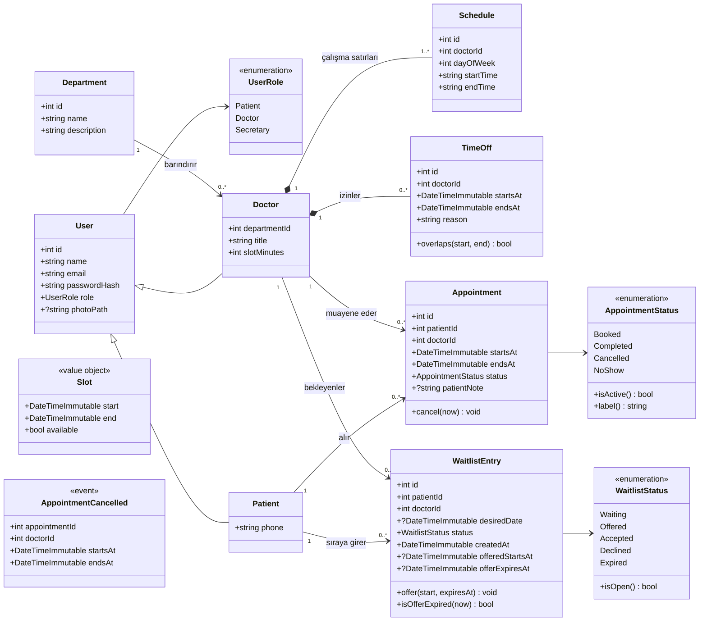
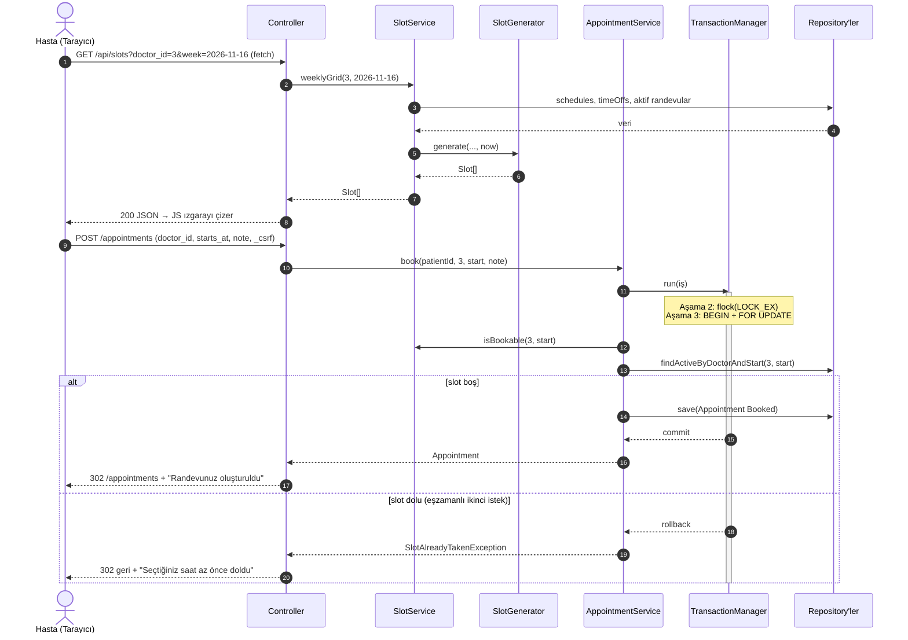
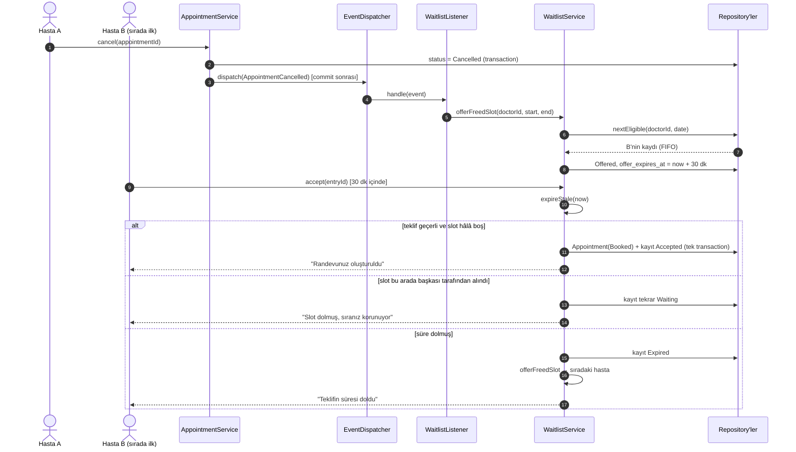
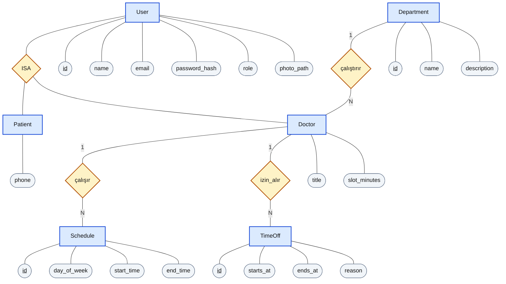
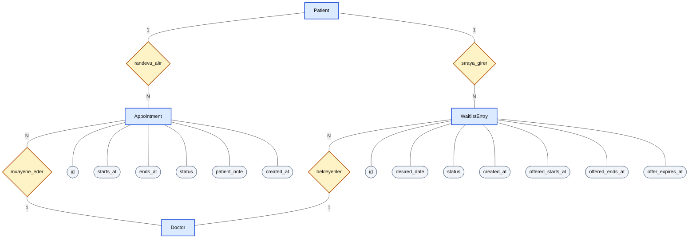

# Klinik Randevu Sistemi Tasarım Belgesi

> **Sürüm:** Aşama 2 revizyonu (10.11.2026). Aşama 2 uygulaması tamamlandı; test durumu `docs/test-raporu.md`. Sunum 1 sonrası bölümler arasındaki çelişkiler giderildi ve
> kararlar netleştirildi (bkz. `docs/ai-gunlugu/004-10.11.2026.md`). Sunum 1'deki sürüm git geçmişindedir.
>
> **Aşama 2 kapsamı:** Veritabanı bağlantısı **yoktur**. Veriler `storage/data/*.json` dosyalarında tutulur ve
> Repository arayüzlerinin JSON uygulamalarıyla okunur. Aşama 3'te yalnızca Repository uygulaması (PDO + MySQL)
> değişir; servisler, controller'lar ve testler aynı kalır.

## Sunum 1 anlatım dağılımı

| Bölüm | Anlatan |
| --- | --- |
| Proje, çekirdek problem, roller, mimari, 4. ER diyagramı, 7. Riskler, 8. Plan | Hatice |
| 2. Sınıf diyagramı, 5. Tasarım desenleri, 3. Sıralama diyagramı, 6. Arayüz | Efe |

## 0. Kapsam ve Roller

Sistemde **3 rol** vardır:

| Rol | Yapabildikleri |
| --- | --- |
| **Hasta** (`patient`) | Kayıt olur; poliklinik → doktor seçip haftalık ızgaradan boş slot alır; **yalnızca kendi** randevularını görür, iptal eder, tarihini değiştirir; bekleme listesine girer, teklifi kabul/ret eder; profil fotoğrafı yükler. |
| **Doktor** (`doctor`) | Kendi günlük randevu listesini görür; geçmiş randevuyu `Completed` veya `NoShow` olarak işaretler. |
| **Sekreter** (`secretary`) | Tüm randevuları arar/filtreler, hasta adına randevu alır/iptal eder; doktorların çalışma takvimini ve izinlerini yönetir; bekleme listesini izler; günlük randevu raporunu görür. |

**Kapsam dışı:** SMS, e-posta, ödeme, tıbbi kayıt, Admin paneli, denetim kaydı (audit log), acil blok (blocked slots).
Bekleme listesi teklifi uygulama içinde (hasta panelinde) gösterilir.

---

## 1. Mimari

### 1.1 Katmanlar

Bağımlılık yönü **yukarıdan aşağıya** doğrudur; alt katman üst katmanı bilmez.

| Katman | Klasör | Sorumluluk | Yasak |
| --- | --- | --- | --- |
| **Router** | `public/index.php`, `src/Core/Router` | Tek giriş noktası; yol + yönteme göre controller'ı bulur, middleware'leri (CSRF, oturum, rol) çalıştırır | İş mantığı |
| **Controller** | `src/Controller` | Girdiyi alır ve biçimsel doğrular, servisi çağırır, görünümü seçer, `Response` döndürür (HTML, JSON veya yönlendirme) | İş kuralı, veri erişimi |
| **Service** | `src/Service` | Tüm iş kuralları: slot üretimi, çakışma önleme, bekleme listesi, yetki/sahiplik, rapor hesapları; transaction sınırı | SQL / dosya erişimi, `$_POST`, HTML |
| **Repository** | `src/Repository` | Veri erişimi. `Contract/` arayüzler, `Json/` Aşama 2 uygulaması, `Mysql/` Aşama 3 uygulaması | İş kuralı |
| **Model** | `src/Model` | Varlıklar (entity), enum'lar, olaylar (event), değer nesneleri (`Slot`) | Altyapıya bağımlılık |
| **View** | `views/` | Yalnızca gösterim; tüm çıktılar `e()` (`htmlspecialchars`) ile kaçışlanır | İş mantığı |
| **Core** | `src/Core` | Framework yerine kendi yazdığımız altyapı: Router, Request/Response, DI Container, View, Session, CSRF, Clock, EventDispatcher | Projeye özgü iş kuralı |

### 1.2 Katman Şeması

```
┌──────────────────────────────────────────────────────────────────┐
│  TARAYICI   views/*.php · Bootstrap 5 · public/assets/js (fetch) │
└───────────────┬──────────────────────────────────▲───────────────┘
                │ HTTP (form / fetch)               │ HTML | JSON | 302
┌───────────────▼──────────────────────────────────┴───────────────┐
│  public/index.php → Application → Router                         │
│  Middleware: CsrfMiddleware → AuthMiddleware → RoleMiddleware    │
├──────────────────────────────────────────────────────────────────┤
│  CONTROLLER  Home · Auth · Appointment · SlotApi · Waitlist ·    │
│              DoctorPanel · Secretary · Report · Profile          │
└───────────────┬──────────────────────────────────────────────────┘
                │ servis çağrısı
┌───────────────▼──────────────────────────────────────────────────┐
│  SERVICE  SlotGenerator (saf)   SlotService   AppointmentService │
│           WaitlistService   AuthService   ScheduleService        │
│           ReportService   ProfilePhotoService                    │
│                │ dispatch(AppointmentCancelled)                  │
│                ▼                                                 │
│           EventDispatcher ──► WaitlistListener ──► WaitlistService│
└───────────────┬──────────────────────────────────────────────────┘
                │ arayüz üzerinden (…RepositoryInterface, TransactionManagerInterface)
┌───────────────▼──────────────────────────────────────────────────┐
│  REPOSITORY  Contract/  ◄── Json/ (Aşama 2)   ◄── Mysql/ (Aşama 3)│
└───────────────┬──────────────────────────────────────────────────┘
                │
┌───────────────▼──────────────────────────────────────────────────┐
│  VERİ   Aşama 2: storage/data/*.json (+ flock)                   │
│         Aşama 3: MySQL 8 (transaction + FOR UPDATE + UNIQUE)     │
└──────────────────────────────────────────────────────────────────┘
Yan bileşenler (her katman kullanabilir): Model (entity, enum, event), ClockInterface
```

### 1.3 Klasör Yapısı

```
clinic-appointment-system/
├── bin/
│   ├── seed.php                     # storage/data/*.json örnek verisini üretir (Aşama 2)
│   └── process-waitlist.php         # Süresi dolan teklifleri işler (demo / elle)
├── config/
│   ├── app.php                      # Saat dilimi, teklif süresi (30 dk), yollar, yükleme kuralları
│   ├── services.php                 # DI bağlamaları: arayüz → JSON (Aşama 3: MySQL) uygulaması
│   ├── events.php                   # Observer kayıtları: olay → dinleyiciler
│   └── routes.php                   # URL → Controller::metot (+ middleware)
├── database/                        # Aşama 3: migrations/*.sql, seeds/*.sql
├── docker/php.ini
├── docs/                            # tasarim.md, SRS, ai-gunlugu/, UI/, test raporu
├── public/                          # DocumentRoot (dışarıya açık TEK klasör)
│   ├── .htaccess · index.php
│   └── assets/{css,js}              # app.css, app.js, slots.js (AJAX ızgara)
├── src/                             # Namespace: App\
│   ├── Core/                        # Application, Container, Config, helpers.php
│   │   ├── Clock/                   # ClockInterface, SystemClock, FrozenClock
│   │   ├── Event/                   # EventDispatcher, EventListenerInterface
│   │   ├── Exception/               # HttpException, ContainerException
│   │   ├── Http/                    # Request, Response
│   │   ├── Middleware/              # MiddlewareInterface, CsrfMiddleware (+ Auth, Role: Faz 6)
│   │   ├── Router/                  # Router, Route
│   │   ├── Session/                 # Session (flash, eski girdi), Csrf
│   │   └── View/                    # View
│   ├── Controller/                  # *Controller.php
│   ├── Service/                     # *Service.php, SlotGenerator.php, Exception/
│   ├── Repository/
│   │   ├── Contract/                # *RepositoryInterface.php, TransactionManagerInterface.php
│   │   ├── Json/                    # JsonStore, FileLockTransactionManager, Json*Repository
│   │   └── Mysql/                   # (Aşama 3) Pdo*, PdoTransactionManager
│   └── Model/                       # Entity, Enum, Event, Slot
├── storage/                         # Tarayıcıdan erişilemez, git'e girmez
│   ├── data/                        # *.json veri dosyaları + .lock
│   ├── uploads/                     # Profil fotoğrafları (rastgele adlı)
│   └── logs/
├── tests/
│   ├── Unit/                        # Saf testler (Core, SlotGenerator, servisler + JSON repo)
│   ├── Integration/                 # Eşzamanlılık (iki ayrı PHP süreci)
│   └── Fixtures/
├── views/{layouts,partials,errors,home,auth,patient,doctor,secretary}/
├── Dockerfile · docker-compose.yml · .env.example
├── composer.json · phpunit.xml · phpstan.neon
└── README.md
```

### 1.4 İstek Yaşam Döngüsü

1. Apache, var olmayan her yolu `.htaccess` ile `public/index.php`'ye yönlendirir.
2. `Application` kurulur: `config/app.php` → çekirdek servisler → `config/services.php` → `config/events.php` → `config/routes.php`.
3. Oturum başlatılır; önceki istekten kalan **flash mesajları**, **eski form girdisi** ve **CSRF jetonu** görünümlere paylaştırılır.
4. `Router` rotayı bulur (`/appointments/{id}/cancel` gibi parametreli yollar desteklenir); bulamazsa 404, yöntem yanlışsa 405.
5. Middleware zinciri: `CsrfMiddleware` (GET dışı her istekte) → `AuthMiddleware` → `RoleMiddleware`.
6. Controller servisi çağırır ve `Response` döndürür. `HttpException` → hata sayfası veya JSON hata; beklenmeyen hata → `storage/logs/app.log` + 500 (ayrıntı yalnızca `APP_DEBUG=1`).

### 1.5 Örnek Akışlar

**Randevu alma**
1. Hasta poliklinik ve doktor seçer; `slots.js`, `GET /api/slots?doctor_id=3&week=2026-11-16` isteğini `fetch` ile atar.
2. `SlotApiController::index()` → `SlotService::weeklyGrid()`; servis `ScheduleRepository`, `TimeOffRepository`, `AppointmentRepository`'den veriyi alır ve saf `SlotGenerator`'a verir. Sonuç **JSON** döner, JS ızgarayı çizer.
3. Hasta boş slotu seçer, isteğe bağlı not yazar → `POST /appointments` → `AppointmentService::book()`.
4. Servis `TransactionManager::run()` içinde: slot geçerli mi (takvimden üretilebiliyor mu, gelecekte mi), doktorun o saatte aktif randevusu var mı, hastanın aynı saatte başka randevusu var mı? Hepsi geçerse kaydeder. Dolu ise `SlotAlreadyTakenException` → "Seçtiğiniz saat az önce doldu" mesajı.

**İptal ve bekleme listesi**
1. `AppointmentService::cancel()` sahipliği ve durumu kontrol eder (yalnızca `Booked` ve gelecekteki randevu), durumu `Cancelled` yapar.
2. Transaction **tamamlandıktan sonra** `AppointmentCancelled` olayı yayınlanır.
3. `WaitlistListener` → `WaitlistService::offerFreedSlot()`: o doktor için uygun ilk `Waiting` kaydına (FIFO) 30 dakikalık teklif verir (`Offered`, `offered_starts_at`, `offer_expires_at`).
4. Teklif süresince slot **herkese açık kalır**. Hasta kabul ederse (`POST /waitlist/{id}/accept`) servis transaction içinde slotun hâlâ boş olduğunu kontrol eder:
   - Boşsa randevu oluşur, kayıt `Accepted` olur.
   - Başkası almışsa teklif düşer, kayıt sıradaki yerini kaybetmeden `Waiting`'e döner ve hastaya "slot dolmuş" denir.
5. Ret (`Declined`) veya süre dolumu (`Expired`) → aynı slot sıradaki uygun hastaya teklif edilir.
6. Süre dolumları cron gerektirmez: hasta/sekreter panelleri ve slot uçları açılırken `WaitlistService::expireStale(now)` çalışır. Demo için `bin/process-waitlist.php` aynı metodu çağırır.

**Tarih/saat değiştirme**
`AppointmentService::reschedule()` tek transaction içinde yeni slotu alır ve eskisini `Cancelled` yapar; commit sonrası eski slot için `AppointmentCancelled` yayınlanır, bekleme listesi tetiklenir.

**Doktorun durum güncellemesi**
`POST /doctor/appointments/{id}/status`: yalnızca kendi randevusu ve başlangıç saati geçmişse `Booked → Completed | NoShow`.

### 1.6 İş Kuralları

| No | Kural |
| --- | --- |
| K1 | Slot süresi doktora özgüdür (`doctors.slot_minutes`). |
| K2 | Bir gün birden fazla çalışma satırından oluşabilir (09:00–12:00, 13:00–17:00). **Öğle arası iki satır arasındaki boşluktur**; slot satır sınırını aşamaz (11:45'te başlayan 30 dk'lık slot üretilmez). |
| K3 | Aynı doktorun aynı gündeki çalışma satırları çakışamaz (kayıt sırasında doğrulanır). |
| K4 | `time_off` bir tarih-saat aralığıdır; tam gün izin veya gün içi istisna (ör. 14:00–16:00 toplantı) olabilir. Aralıkla **kesişen** slot üretilmez. |
| K5 | Geçmiş slotlar alınamaz; ızgarada gösterilmez veya pasif görünür. |
| K6 | Bir doktorun bir slotunda en fazla **bir aktif** (`Booked`) randevu olabilir. Aşama 2'de `flock`, Aşama 3'te `FOR UPDATE` + UNIQUE `active_slot_key` ile garanti edilir. |
| K7 | Bir hastanın aynı saatte çakışan iki aktif randevusu olamaz. |
| K8 | Hasta yalnızca kendi randevularını görür/değiştirir; doktor yalnızca kendi listesini görür. Sahiplik kontrolü **serviste** yapılır. |
| K9 | İptal yalnızca `Booked` ve başlangıcı gelecekte olan randevuda yapılabilir. |
| K10 | Bir hastanın bir doktor için en fazla bir açık (`Waiting`/`Offered`) bekleme kaydı olabilir. |
| K11 | Teklif sırası: aynı doktor, `desired_date` boş veya slot tarihine eşit, `created_at` (eşitlikte `id`) en eski. Aynı slot için aynı anda tek teklif vardır. |
| K12 | Teklif süresi `config/app.php` → `waitlist_offer_minutes` (30). |

### 1.7 Tasarım Kararları ve Gerekçeleri

**Neden katmanlı ve katman bazlı klasör?** Hocanın zorunlu yapısı `Controller/Service/Repository/Model`'dir. Çekirdek problemler (slot, çakışma, kuyruk) saf iş mantığıdır ve serviste tek yerde durduğu için doğrudan birim testlerle kanıtlanır.

**Neden Repository arayüzü + JSON uygulaması?** Aşama 2'de veritabanı yoktur. Servisler somut sınıfa değil arayüze bağımlıdır; `config/services.php`'deki bağlama değiştirilerek Aşama 3'e geçilir.

**Neden `TransactionManagerInterface`?** "Kontrol et + kaydet" tek atomik iş kuralıdır, sınırı serviste olmalıdır. Servis yalnızca `$tx->run(fn () => ...)` çağırır:
- `FileLockTransactionManager` (Aşama 2): `storage/data/.lock` dosyasına `flock(LOCK_EX)` alır, işlem bitene kadar diğer istekler bekler. Dosyalar geçici dosyaya yazılıp `rename` ile atomik değiştirilir.
- `PdoTransactionManager` (Aşama 3): `beginTransaction/commit/rollBack`. Repository'de `SELECT ... FOR UPDATE` ve UNIQUE `active_slot_key` son savunma olarak kalır.

**Neden olaylar commit'ten sonra yayınlanır?** Dinleyici (bekleme listesi) kendi transaction'ını açar. İptal geri alınırsa (rollback) teklif gönderilmemelidir.

**Neden `SlotGenerator` saf sınıf?** Girdi: takvim satırları, izinler, dolu randevular, hafta, slot süresi, "şimdi". Çıktı: `Slot` listesi. Dosya/DB'ye dokunmadığı için deterministiktir; "izinde slot yok" ve "öğle arası atlanıyor" testleri milisaniyede çalışır.

**Neden `ClockInterface`?** "Şimdi" dışarıdan verilir. Testte `FrozenClock` ile zaman 31 dakika ileri alınıp teklifin düştüğü kanıtlanır.

**Neden AJAX'ta JSON?** Ortak şart "en az bir JSON döndüren uç nokta ve onu kullanan JavaScript" ister. Slot ızgarası `GET /api/slots` ile JSON olarak gelir, `slots.js` DOM'u oluşturur (değerler `textContent` ile basılır, XSS yok).

**Neden middleware?** CSRF ve rol kontrolü rota seviyesinde merkezi uygulanır; controller'larda dağınık `if` olmaz. Kaynak sahipliği (K8) ise iş kuralı olduğu için serviste kontrol edilir.

**Neden `public/` tek giriş?** Apache'nin DocumentRoot'u `public/`'tir; `src/`, `config/`, `storage/` (JSON veriler, fotoğraflar) dışarıdan erişilemez.

**Neden teklif süresince slot açık?** Ekip kararı: akış basit kalır, iptal edilen slot boşta beklemez. Bedeli: kabulde slotun hâlâ boş olduğu transaction içinde yeniden kontrol edilir (K6).

---

## 2. Sınıf Diyagramı

Okunabilirlik için iki parçaya bölünmüştür.

**Şekil 2.1: Model (varlıklar, enum'lar, olay)**



**Şekil 2.2: Katmanlar, Repository ve Observer**

```mermaid
classDiagram
    direction TB

    class AppointmentController {
        +store(Request) Response
        +cancel(Request) Response
        +reschedule(Request) Response
    }
    class SlotApiController {
        +index(Request) Response
    }
    class WaitlistController {
        +join(Request) Response
        +accept(Request) Response
        +decline(Request) Response
    }

    class SlotGenerator {
        +generate(schedules, timeOffs, booked, weekStart, slotMinutes, now) Slot[]
    }
    class SlotService {
        +weeklyGrid(doctorId, weekStart) Slot[]
        +isBookable(doctorId, start) bool
    }
    class AppointmentService {
        +book(patientId, doctorId, start, note) Appointment
        +cancel(appointmentId, actor) void
        +reschedule(appointmentId, newStart, actor) Appointment
        +markStatus(appointmentId, status, doctor) void
    }
    class WaitlistService {
        +join(patientId, doctorId, desiredDate) WaitlistEntry
        +offerFreedSlot(doctorId, start, end) void
        +accept(entryId, patientId) Appointment
        +decline(entryId, patientId) void
        +expireStale() int
    }

    class EventDispatcher {
        +listen(eventClass, listener) void
        +dispatch(event) void
    }
    class EventListenerInterface {
        <<interface>>
        +handle(object event) void
    }
    class WaitlistListener {
        +handle(object event) void
    }
    class ClockInterface {
        <<interface>>
        +now() DateTimeImmutable
    }
    class TransactionManagerInterface {
        <<interface>>
        +run(callable work) mixed
    }
    class FileLockTransactionManager
    class AppointmentRepositoryInterface {
        <<interface>>
        +find(id) ?Appointment
        +findActiveForDoctorBetween(doctorId, from, to) Appointment[]
        +findActiveByDoctorAndStart(doctorId, start) ?Appointment
        +findForPatient(patientId) Appointment[]
        +search(AppointmentFilter) Appointment[]
        +save(Appointment) Appointment
    }
    class JsonAppointmentRepository
    class WaitlistRepositoryInterface {
        <<interface>>
        +find(id) ?WaitlistEntry
        +nextEligible(doctorId, date) ?WaitlistEntry
        +findExpiredOffers(now) WaitlistEntry[]
        +save(WaitlistEntry) WaitlistEntry
    }
    class JsonWaitlistRepository
    class ScheduleRepositoryInterface {
        <<interface>>
        +forDoctor(doctorId) Schedule[]
    }
    class TimeOffRepositoryInterface {
        <<interface>>
        +forDoctorBetween(doctorId, from, to) TimeOff[]
    }

    AppointmentController ..> AppointmentService
    SlotApiController ..> SlotService
    WaitlistController ..> WaitlistService

    SlotService --> SlotGenerator
    SlotService --> ScheduleRepositoryInterface
    SlotService --> TimeOffRepositoryInterface
    SlotService --> AppointmentRepositoryInterface
    AppointmentService --> SlotService
    AppointmentService --> AppointmentRepositoryInterface
    AppointmentService --> TransactionManagerInterface
    AppointmentService --> EventDispatcher : AppointmentCancelled
    AppointmentService --> ClockInterface
    WaitlistService --> WaitlistRepositoryInterface
    WaitlistService --> AppointmentRepositoryInterface
    WaitlistService --> TransactionManagerInterface
    WaitlistService --> ClockInterface

    EventDispatcher o--> EventListenerInterface : dinleyiciler
    WaitlistListener ..|> EventListenerInterface
    WaitlistListener --> WaitlistService

    FileLockTransactionManager ..|> TransactionManagerInterface
    JsonAppointmentRepository ..|> AppointmentRepositoryInterface
    JsonWaitlistRepository ..|> WaitlistRepositoryInterface
```



Diyagramda yer kazanmak için gösterilmeyen sınıflar: `UserRepositoryInterface`, `DepartmentRepositoryInterface`, `DoctorRepositoryInterface`, `PatientRepositoryInterface` ve JSON uygulamaları; `AuthService`, `ScheduleService`, `ReportService`, `ProfilePhotoService`; `HomeController`, `AuthController`, `DoctorPanelController`, `SecretaryController`, `ReportController`, `ProfileController`. Aşama 3'te her `Json*Repository`'nin yanına `Pdo*Repository`, `FileLockTransactionManager`'ın yanına `PdoTransactionManager` eklenir.

---

## 3. Sıralama Diyagramları

**Şekil 3.1: Slot listeleme (AJAX) ve randevu alma, eşzamanlı çakışma dalı**



**Şekil 3.2: İptal → Observer → bekleme listesi teklifi → kabul**



---

## 4. ER Diyagramı

Aşama 3'te kurulacak veritabanının planıdır. Aşama 2'de her tablo bir JSON dosyasıdır (`storage/data/<tablo>.json`), alan adları aynıdır; böylece geçiş yalnızca Repository uygulamasını değiştirir.

### 4.1 Sınıflardan tablolara

| Sınıf | Tablo | Açıklama |
| --- | --- | --- |
| User | `users` | Ortak hesap bilgileri; `role`: patient, doctor, secretary |
| Patient | `patients` | User'dan kalıtım; birincil anahtarı `users.id` |
| Doctor | `doctors` | User'dan kalıtım; birincil anahtarı `users.id` |
| (Sekreter) | — | Ek özniteliği yok; `users.role = 'secretary'` |
| Department | `departments` | Poliklinikler |
| Schedule | `schedules` | Doktorun haftalık çalışma satırları |
| TimeOff | `time_off` | İzin ve istisna aralıkları |
| Appointment | `appointments` | Randevular |
| WaitlistEntry | `waitlist` | Bekleme listesi ve teklif bilgisi |
| Slot | — | Kaydedilmez; `SlotGenerator` anlık hesaplar |

### 4.2 ER diyagramı (Chen gösterimi)

`ISA` ("is a"), Patient ve Doctor'un birer User olduğunu (kalıtım) gösterir.

**Şekil 4.1: Kullanıcılar, doktor ve çalışma planı**



**Şekil 4.2: Randevu ve bekleme listesi** (Patient ve Doctor öznitelikleri Şekil 4.1'de)



### 4.3 Tablolar, anahtarlar ve kısıtlar

| Tablo | Sütunlar | Anahtar / kısıt |
| --- | --- | --- |
| `users` | id, name, email, password_hash, role, photo_path NULL, created_at | PK id · UNIQUE email · role ∈ {patient, doctor, secretary} |
| `patients` | user_id, phone | PK/FK user_id → users.id |
| `departments` | id, name, description | PK id · UNIQUE name |
| `doctors` | user_id, department_id, title, slot_minutes | PK/FK user_id → users.id · FK department_id → departments.id · slot_minutes > 0 |
| `schedules` | id, doctor_id, day_of_week, start_time, end_time | FK doctor_id · day_of_week 1–7 (ISO, 1 = Pazartesi) · end_time > start_time · aynı gün satırları çakışamaz (K3) |
| `time_off` | id, doctor_id, starts_at, ends_at, reason | FK doctor_id · ends_at > starts_at |
| `appointments` | id, patient_id, doctor_id, starts_at, ends_at, status, patient_note NULL, created_at, cancelled_at NULL | FK patient_id, doctor_id · status ∈ {booked, completed, cancelled, no_show} · **UNIQUE active_slot_key** (Aşama 3) |
| `waitlist` | id, patient_id, doctor_id, desired_date NULL, status, created_at, offered_starts_at NULL, offered_ends_at NULL, offer_expires_at NULL | FK patient_id, doctor_id · status ∈ {waiting, offered, accepted, declined, expired} · INDEX (doctor_id, status, created_at) |

**Çift randevuyu veritabanında engellemek (Aşama 3):** MySQL'de kısmi UNIQUE indeks yoktur. İptal edilen satırın slotu kilitlememesi için üretilmiş (generated) sütun kullanılır:

```sql
active_slot_key VARCHAR(40) AS (
    IF(status = 'booked', CONCAT(doctor_id, '|', starts_at), NULL)
) STORED,
UNIQUE KEY uq_active_slot (active_slot_key)
```

MySQL UNIQUE'te birden fazla `NULL`'a izin verdiği için iptal/tamamlanmış randevular çakışmaz. Aşama 2'de bu garantiyi `flock` ile tek seferde tek yazıcı sağlar.

### 4.4 3NF kontrolü

| Kural | Bu tasarımda nasıl sağlandı? |
| --- | --- |
| 1NF | Her hücre tek değer. Çalışma saatleri tek metin değil, her aralık ayrı `schedules` satırı; izinler ayrı `time_off` satırları. |
| 2NF | Tüm tablolarda birincil anahtar tek sütun; kısmi bağımlılık oluşamaz. |
| 3NF | `appointments` içinde hasta/doktor adı veya poliklinik tutulmaz; doktorun polikliniği `doctors.department_id`, adı `users` üzerinden gelir. `appointments.ends_at` saklanır, çünkü `slot_minutes` sonradan değişebilir ve geçmiş randevunun süresi o anki değere bağlı olmamalıdır. Bu sütun başka bir anahtar olmayan sütundan türetilmiş değil, randevuya ait bir olgudur. |

### 4.5 Gerekçe

Hasta, doktor ve sekreterin ortak bilgileri (ad, e-posta, parola özeti, rol, fotoğraf) `users`'ta toplanır; hastaya ve doktora özel alanlar kendi tablolarında durur ve aynı `id` ile `users`'a bağlanır. Böylece sınıf diyagramındaki kalıtım tabloya birebir yansır ve giriş/yetki kontrolü tek tablodan yürür. Boş randevu saatleri tabloya yazılmaz; çalışma planından ve izinlerden anlık hesaplanır. Randevu ve bekleme kaydı, hasta ile doktor arasındaki N-M ilişkiyi kuran ara tablolardır.

---

## 5. Tasarım Desenleri

### 5.1 Repository

**Nerede:** `src/Repository/Contract/*RepositoryInterface` ve uygulamaları `Json/` (Aşama 2), `Mysql/` (Aşama 3).

**Nasıl:** Servisler yalnızca arayüzü bilir. Hangi uygulamanın verileceği `config/services.php`'de tek satırla belirlenir:

```php
$c->singleton(AppointmentRepositoryInterface::class,
    fn (Container $c) => new JsonAppointmentRepository($c->get(JsonStore::class)));
// Aşama 3: new PdoAppointmentRepository($c->get(PDO::class))
```

**Neden:**
- Dönem planı veri katmanını JSON'dan MySQL'e değiştirmeyi şart koşuyor; Repository olmadan bu geçiş tüm servislerin yeniden yazılması demek olurdu.
- Testler gerçek veri katmanına bağlı kalmaz: servis testleri geçici klasördeki JSON veya bellek içi sahte repository ile çalışır.
- Kilit ve sorgu ayrıntıları (`flock`, `FOR UPDATE`, JOIN) tek yerde toplanır, servisler okunaklı kalır.

### 5.2 Observer

**Nerede:** `src/Core/Event/EventDispatcher` (özne), `EventListenerInterface` (gözlemci), `src/Model/Event/AppointmentCancelled` (olay), `src/Service/WaitlistListener` (somut gözlemci), kayıtlar `config/events.php`.

**Nasıl:**

```php
// config/events.php
return [
    AppointmentCancelled::class => [WaitlistListener::class],
];

// AppointmentService::cancel()
$this->tx->run(fn () => /* durumu Cancelled yap */);
$this->events->dispatch(new AppointmentCancelled($id, $doctorId, $startsAt, $endsAt));
```

**Neden:**
- Proje isteri açıkça "iptal olayı bekleme listesini tetikler" der.
- `AppointmentService` bekleme listesini tanımaz; yalnızca "iptal oldu" der. Randevu değiştirme (reschedule) de aynı olayı yayınladığı için bekleme listesi ikinci kez kodlanmaz.
- Yeni bir tepki (ör. ileride rapor önbelleğini temizlemek) mevcut servisi değiştirmeden yeni dinleyiciyle eklenir (açık/kapalı ilkesi).

### 5.3 Destekleyici desenler

| Desen | Nerede | Neden |
| --- | --- | --- |
| **Front Controller** | `public/index.php` → `Application` | Tüm istekler tek noktadan geçer; güvenlik ve hata yönetimi merkezi |
| **Chain of Responsibility** | `MiddlewareInterface` zinciri (CSRF → Auth → Role) | Her halka isteği ya durdurur ya `$next` ile iletir; yetki kontrolleri controller'dan ayrılır |
| **Dependency Injection** | `src/Core/Container` | Servisler bağımlılıklarını yapıcıdan alır; testte sahte nesne verilebilir |
| **Strategy** | `TransactionManagerInterface` (FileLock / Pdo), `ClockInterface` (System / Frozen) | Aynı servis kodu farklı ortamlarda farklı stratejiyle çalışır |

---

## 6. Arayüz

Taslak ekranlar `docs/UI/` altındadır (anasayfa, giriş, kayıt, randevu paneli, sekreter paneli). Tüm ekranlar 375 px genişlikte yatay kaydırmasız çalışır (Bootstrap 5 grid), hatalı form gönderiminde girilen değerler korunur, başarı/hata mesajları flash ile gösterilir.

| Ekran | Rol | Önemli öğeler |
| --- | --- | --- |
| Giriş / Kayıt | Herkes | CSRF, hatalı girişte e-posta korunur |
| Randevu al | Hasta | Poliklinik → doktor seçimi, **haftalık slot ızgarası (AJAX/JSON)**, hafta ileri/geri, not alanı, "Bekleme listesine gir" |
| Randevularım | Hasta | Aktif/geçmiş sekmeleri, iptal, tarih değiştirme, bekleyen teklif kartı (kalan süre, kabul/ret) |
| Profil | Herkes | Profil fotoğrafı yükleme |
| Doktor paneli | Doktor | Günlük liste (tarih seçici), Completed / NoShow işaretleme |
| Sekreter paneli | Sekreter | Randevu arama (hasta adı/e-posta) + filtre (poliklinik, doktor, durum, tarih), hasta adına randevu, takvim ve izin yönetimi, bekleme listesi görünümü |
| Günlük rapor | Sekreter | Seçilen gün için randevu listesi (JOIN), durum bazında toplamlar, iptal oranı, doluluk oranı |

**Uç noktalar** (tam liste: `config/routes.php`)

| Yöntem | Yol | Rol (middleware) |
| --- | --- | --- |
| GET/POST | `/login`, `/register`; POST `/logout` | Herkes |
| GET | `/api/doctors?department_id=` → JSON | Hasta, Sekreter |
| GET | `/api/slots?doctor_id=&week=` → JSON | Hasta, Sekreter |
| GET | `/appointments`, `/appointments/book`; POST `/appointments` | Hasta |
| GET/POST | `/appointments/{id}/reschedule`; POST `/appointments/{id}/cancel` | Hasta (kendi), Sekreter |
| POST | `/waitlist`, `/waitlist/{id}/accept`, `/waitlist/{id}/decline`, `/waitlist/{id}/leave` | Hasta |
| GET | `/doctor?date=`; POST `/doctor/appointments/{id}/status` | Doktor |
| GET | `/secretary` (arama + filtre), `/secretary/appointments/new`, `/secretary/waitlist`; POST `/secretary/appointments` | Sekreter |
| GET | `/secretary/doctors`, `/secretary/doctors/{id}` | Sekreter |
| POST | `/secretary/doctors/{id}/schedules`, `/secretary/schedules/{id}/delete`, `/secretary/doctors/{id}/time-off`, `/secretary/time-off/{id}/delete` | Sekreter |
| GET | `/reports/daily?date=&department_id=` | Sekreter |
| GET | `/profile`, `/users/{id}/photo`; POST `/profile/photo` | Giriş yapmış kullanıcı |

GET dışındaki tüm isteklerde CSRF jetonu zorunludur (formlarda `_csrf`, AJAX'ta `X-CSRF-Token`); geçersizse 403.

**Güvenli dosya yükleme (profil fotoğrafı):** `UPLOAD_ERR_OK` kontrolü → boyut ≤ 2 MB → `finfo` ile gerçek MIME türü (jpeg/png/webp beyaz listesi) → `getimagesize` ile görüntü doğrulaması → `bin2hex(random_bytes(16))` + uzantı ile rastgele ad → `storage/uploads/` (public dışı) → `GET /users/{id}/photo` ile doğru `Content-Type` ve `X-Content-Type-Options: nosniff` başlığıyla sunulur.

---

## 7. Riskler

| Risk | Olasılık | Etki | Önlem |
| --- | --- | --- | --- |
| Aynı doktora aynı slotta birden fazla randevu | Orta | Yüksek | Aşama 2: `flock` ile tek yazıcı; Aşama 3: transaction + `FOR UPDATE` + UNIQUE `active_slot_key`; iki ayrı PHP süreciyle eşzamanlılık testi |
| İzin, istisna veya öğle arasının takvime yanlış yansıması | Orta | Yüksek | Saf `SlotGenerator` için tam gün izin, gün içi istisna, öğle boşluğu, satır sınırı senaryolarını kapsayan birim testleri |
| Bekleme listesinde teklifin yanlış hastaya gitmesi | Orta | Yüksek | FIFO kuralı (K11) açıkça tanımlı; sıra ve eşitlik durumları test edilir |
| Teklif süresinin dolmasına rağmen sıradakine geçilmemesi | Orta | Yüksek | `ClockInterface` + `FrozenClock` ile 30 dk sınırı testi; süre dolumu istek anında ve CLI betiğiyle işlenir |
| Teklif kabul edilirken slotun başkası tarafından alınmış olması | Orta | Orta | Kabul işlemi transaction içinde slotu yeniden kontrol eder; hasta sırasını kaybetmez |
| Hastanın başka hastanın randevusuna erişmesi | Düşük | Yüksek | Rol middleware'i + servis katmanında sahiplik kontrolü (K8); erişim testleri |
| İptal/değişiklikte veri tutarsızlığı | Orta | Yüksek | Tek transaction; olaylar commit sonrası yayınlanır |
| JSON dosyasının yarım yazılması | Düşük | Yüksek | Geçici dosyaya yazıp `rename` ile atomik değiştirme |
| Kapsamın genişlemesi | Yüksek | Orta | Admin, audit log, acil blok kapsamdan çıkarıldı; yeni istekler önce bu belgeye işlenir |

---

## 8. Plan

- Proje panosu (backlog): https://github.com/users/denizugurgenc02/projects/2
- Sunum 1: 15.10.2026 (tamamlandı). Sunum 2 ve Sunum 3 tarihleri: **netleştirilecek**.

| Faz | İçerik | Durum |
| --- | --- | --- |
| 0 | Tasarım belgesinin netleştirilmesi (bu belge) | ✅ |
| 1 | Altyapı: Apache Docker, Router (parametreli yol, middleware), DI Container, Request/Response, Session/Flash/CSRF, View, Clock, EventDispatcher, PHPUnit/PHPStan | ✅ |
| 2 | Model: varlıklar, enum'lar, `AppointmentCancelled` | ✅ |
| 3 | `SlotGenerator` (önce test): izin, öğle boşluğu, satır sınırı, geçmiş, dolu | ✅ |
| 4 | Repository arayüzleri + JSON uygulamaları, `FileLockTransactionManager`, `bin/seed.php` (5 poliklinik, 7 doktor) | ✅ |
| 5 | `AppointmentService` (alma/iptal/değiştirme), Observer, `WaitlistService`; eşzamanlılık testi | ✅ |
| 6 | Kayıt/giriş/çıkış, rol middleware'leri, profil fotoğrafı yükleme | ✅ |
| 7 | Ekranlar: hasta, doktor, sekreter, günlük rapor | ✅ |
| 8 | Kalite: 73 test, PHPStan seviye 8 hatasız, izlenebilirlik tablosu (`docs/test-raporu.md`) → **Sunum 2** | ✅ |
| Aşama 3 | MySQL migration + seed, `Pdo*Repository`, `PdoTransactionManager` → **Final** | ⏳ |
